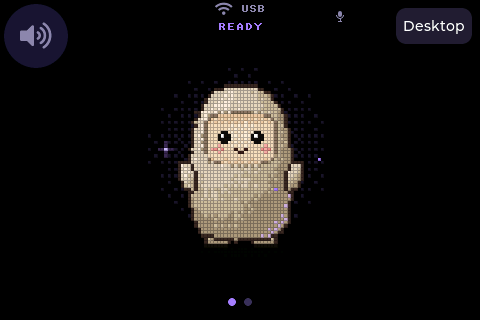
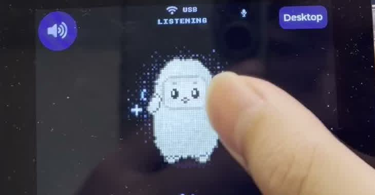

# Muse Gadget on RDK X5

在 RDK X5 上运行 Muse Linux Gadget，并把 ESP32 风格的动画头像、字幕和触摸交互放到 480×320 小屏上。独立社区实现，基于 Meta 的 [Muse Gadget SDK](https://github.com/facebookincubator/muse-gadget-sdk)，不代表官方板卡适配。




## Architecture

```text
Touch screen → LVGL / SDL native UI → Python chat/audio bridge
                                         ↕ encrypted Muse connection
                                      Muse cloud
Headset mic → PulseAudio / PCM voice note ↗     ↘ text → Edge TTS → PulseAudio
Official musegadget.service handles pairing and board commands separately.
```

X5 runs the device client, display and audio plumbing. Model inference happens in Muse's cloud; this project does not run an LLM on the X5 BPU. The frontend uses Muse's original pixel avatar and CJK caption font. English controls, original-language captions, no operation hints. TTS is provided by `edge-tts`, an additional online dependency.

## Tested setup

- RDK X5, Ubuntu 22.04.5 ARM64, XFCE/Xorg desktop.
- A working 480×320 SPI touch display; this project does not install screen or touch drivers.
- Default desktop account `sunrise`, UID 1000, X display `:0`.
- Already installed and paired official Linux SDK, with state under `/var/lib/musegadget`.
- Internet access to Muse, dependency downloads and Edge TTS.

This installer targets that setup. Other usernames, display sessions, HDMI resolutions and audio devices require editing the launcher, systemd units and installer paths. It is not a generic board-image installer.

## Install on X5

First follow the [official Linux SDK setup](https://github.com/facebookincubator/muse-gadget-sdk/tree/main/linux), obtain your own SDK token and pair with the Muse app. Account access/developer mode must be available. Keep tokens on your device; none are included here.

Then, on the board:

```sh
sudo apt-get update
sudo apt-get install -y git
git clone https://github.com/shockley6668/rdk-x5-muse-gadget.git
cd rdk-x5-muse-gadget
# Review the script before installing.
sudo bash install.sh
```

Installs the app under `/opt/muse-ui`, builds the native renderer and runs the backend tests. Adds a Muse desktop icon and XFCE autostart entry. Enables `muse-ui.service` for the chat/audio backend, preserving the official `musegadget.service` and its pairing. The UI launches after XFCE is ready. The installer also configures a PulseAudio combined output and restarts the desktop user's PulseAudio service, interrupting current playback.

The backend currently runs as root so it can read the existing root-owned SDK pairing and contact the desktop audio session. Local input is restricted to root and the `sunrise` group, but captions are written to a world-readable state file in `/run/muse-ui`. Deploy on a trusted, single-user board. Pairing/token files are never copied into this repository or rewritten by the UI.

## Use

- Hold the avatar while speaking; release to send a voice note. Brief taps are discarded.
- Speaker button toggles mute.
- **Desktop** or **Esc** closes the frontend and returns to Ubuntu. The chat backend keeps running.
- Double-click **Muse** on the desktop to reopen. Repeated launches focus the existing window.

The launcher waits for the window manager and desktop to avoid an invisible window at boot. SPI refresh and avatar animation are capped at 8 fps to keep the desktop responsive. The old system-level display service stays disabled; normal autostart is managed by XFCE.

## Audio

The deployed profile uses `PULSE_SOURCE=alsa_input.platform-snd0.stereo-fallback` and `PULSE_SINK=muse_output` in `muse-ui.service`. Use `pactl list short sources` and `pactl list short sinks` in the desktop user's session to check your hardware names.

A headset microphone requires compatible wiring and codec routing; a playback-only headphone cannot record. Bluetooth pairing is performed separately in Ubuntu. `pulse-default.pa` defines an automatic combine sink for connected hardware outputs, intended for simultaneous jack/Bluetooth playback. Output availability, latency, volume and microphone quality depend on the actual devices. `MUSE_UI_MIRROR=0` disables the optional ESP32 chat mirror.

Chinese/English are suggested in the voice-note prompt. This is a language hint, not a guaranteed ASR language whitelist; short or noisy recordings can still be misrecognized.

## Validation and limits

Recorded board checks:

- ARM64 native build and live cloud text response.
- Synthetic Mandarin voice upload with the expected cloud reply; TTS generation/decoding and software playback command succeeded.
- Touch mute/unmute, reconnect after backend restart.
- Desktop/Esc exit and desktop icon reopening, no duplicate UI processes.
- Minimized-window recovery, repeated close/reopen cycles, and a real board reboot with XFCE autostart (2026-10-09).

The included device photo shows the touch interaction and listening state. These checks do not establish microphone recording quality or sound heard simultaneously from the headset and Bluetooth speaker; those physical checks remain to be completed.

The bridge uses SDK internals and cloud chat endpoints; upstream/cloud changes may require updates. No offline mode or service quota guarantees are provided.

Local backend tests (without hardware/network):

```sh
python3 -m venv .venv
.venv/bin/pip install 'websockets==16.0' cryptography
PYTHONPATH=sdk .venv/bin/python -m unittest test_backend -v
```

Renderer build and headless tests: see [simulator/README.md](simulator/README.md).

## Troubleshooting

```sh
systemctl status muse-ui musegadget
journalctl -u muse-ui -n 40 --no-pager
tail -30 /home/sunrise/.cache/muse-ui/launcher.log
python3 /opt/muse-ui/send.py 'Hello, please reply briefly.'
```

Logs and captions can contain conversation text. Redact them before sharing. A working internet connection, DNS and correct system time are prerequisites for cloud connections.

## License and attribution

Apache-2.0 for the code; original Meta notices are preserved. GNU Unifont has a separate font license. See [LICENSE](LICENSE), [NOTICE](NOTICE), and [THIRD_PARTY.md](THIRD_PARTY.md).
