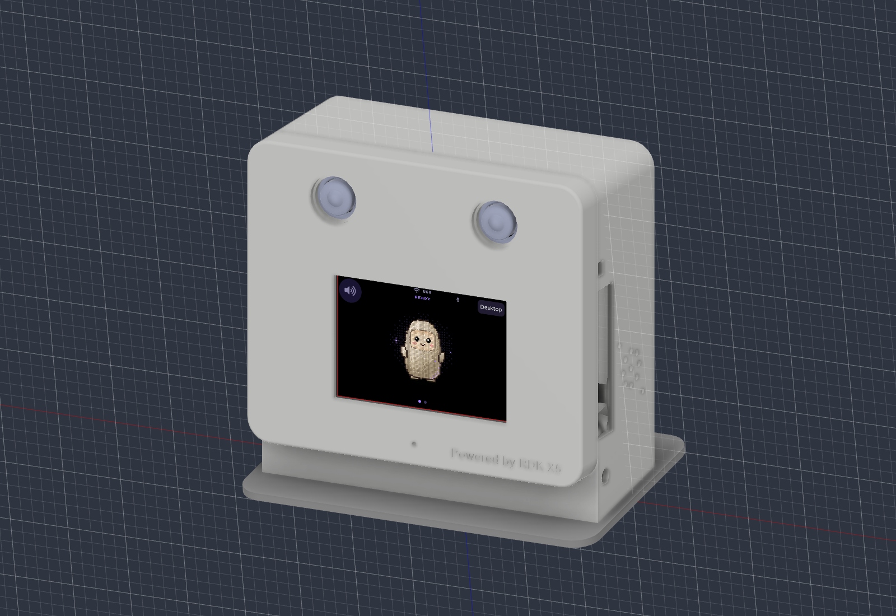

# Muse Gadget on RDK X5

Muse on a 480×320 touchscreen: pixel avatar, chat captions and hold-to-talk voice input. Based on Meta's [Muse Gadget SDK](https://github.com/facebookincubator/muse-gadget-sdk), with an LVGL/SDL interface and Python backend. Conversation and TTS require internet access.



## Quick start

Use an RDK X5 running Ubuntu 22.04 with XFCE and the `sunrise` desktop account.

1. [Set up the SPI screen](docs/SPI-LCD-SETUP.md). The quick installer supports kernel **6.1.83** and **CS1 wiring**. Skip this if display and touch already work.
2. Install and pair the [Muse Linux SDK](https://github.com/facebookincubator/muse-gadget-sdk/tree/main/linux) using your own SDK token.
3. Install the UI on the X5:

```sh
sudo apt-get update
sudo apt-get install -y git
git clone https://github.com/D-Robotics/rdk-x5-muse-gadget.git
cd rdk-x5-muse-gadget
sudo bash install.sh
```

The installer builds the UI in `/opt/muse-ui`, adds the **Muse** desktop shortcut and enables autostart. It also installs a root backend service and configures the desktop user's PulseAudio output.

A compatible microphone and speaker are needed for voice. The current plan uses a CTIA 3.5 mm TRRS microphone and a USB audio speaker. Set the recording device with `PULSE_SOURCE` and the playback device with `PULSE_SINK` in [muse-ui.service](muse-ui.service). The newly selected audio hardware has not been tested on the X5.

## Controls

- Hold the avatar to record; release to send.
- Tap the speaker button to mute or unmute.
- Tap **Desktop** or press **Esc** to close the window.
- Double-click **Muse** on the desktop to reopen it.

## CAD and development

- [CAD files](cad/): editable Fusion model, assembly STEP and six STL parts.
- [Enclosure assembly and fasteners](docs/ENCLOSURE.md).
- [Build and renderer tests](simulator/README.md).
- [Project status](docs/STATUS.md).

V08 adds corrected GS130WI seats, adjustable X5/heatsink clamps, hidden shell snaps and optional screw closure. It is a fit prototype: audio mounts and concealed cable routing are unfinished, and pogo contact still needs checking. GS130WI vision, YOLO and gesture interactions are planned.

## Logs

```sh
systemctl status muse-ui musegadget
journalctl -u muse-ui -n 40 --no-pager
```

## License

[Apache-2.0](LICENSE). See [third-party notices](THIRD_PARTY.md) for fonts, dependencies and vendor CAD.
