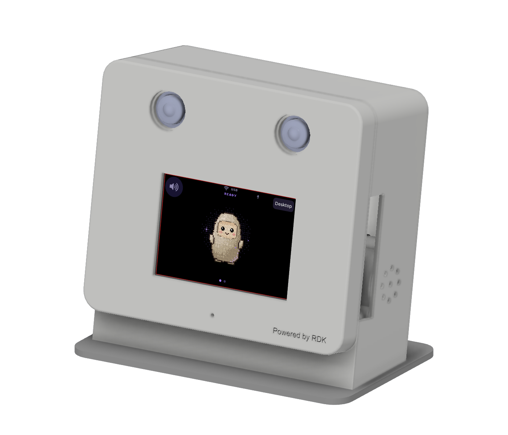

# Muse Gadget on RDK X5

A touchscreen interface for Muse on the RDK X5, with an animated pixel avatar, chat captions and hold-to-talk input. It reuses the ESP32 interface from Meta's [Muse Gadget SDK](https://github.com/facebookincubator/muse-gadget-sdk) and runs on a 480×320 display.



The screen runs a native LVGL/SDL frontend. A Python backend sends messages to Muse and passes replies back to the screen. The official `musegadget` service handles pairing and board commands. Speech output uses Edge TTS and PulseAudio.

Inference runs in Muse's cloud. The X5 handles the interface, device commands and audio. Internet access is required for Muse and speech synthesis.

## Project files

- [SPI display setup](docs/SPI-LCD-SETUP.md): ST7796S DRM display and GT911 touch,
  with the earlier CS1 wiring kept separate from the Waveshare F pogo candidate.
- [Display sources](hardware/display/README.md): overlays, initialization firmware
  generator and Xorg configuration.
- [Enclosure CAD](hardware/enclosure/README.md): V04 Fusion, STEP and STL files,
  assembly views and check reports.
- [Current status](docs/STATUS.md): what is implemented and what remains untested.

The Linux UI/audio bridge runs independently of the enclosure. GS130WI vision,
YOLO, gesture feeding/movement and desktop mini-apps are planned; they are not
implemented in this snapshot. The CAD still uses provisional audio geometry.


## Setup

Tested on:

- RDK X5 running Ubuntu 22.04.5 ARM64 with XFCE/Xorg.
- A 480×320 SPI touchscreen with working display and touch drivers. See the
  [display guide](docs/SPI-LCD-SETUP.md) to bring up the screen first.
- Desktop account `sunrise`, UID 1000, display `:0`.
- The official Linux SDK, already installed and paired with Muse.

The installer uses these account and display settings. For a different username, display resolution or audio device, adjust the launcher, service files and installer paths first.

## Install

Follow the [Linux SDK instructions](https://github.com/facebookincubator/muse-gadget-sdk/tree/main/linux) to install the SDK and pair the board. You need your own SDK token and access to developer mode in the Muse app.

Then run these commands on the X5:

```sh
sudo apt-get update
sudo apt-get install -y git
git clone https://github.com/D-Robotics/rdk-x5-muse-gadget.git
cd rdk-x5-muse-gadget
# Read install.sh before running it.
sudo bash install.sh
```

The installer builds the frontend, runs the backend tests and installs the app in `/opt/muse-ui`. It adds a desktop shortcut and an XFCE autostart entry, then enables `muse-ui.service`. The existing SDK service and pairing stay in place.

It also configures a PulseAudio combined output and restarts the desktop user's audio service. This interrupts any current playback.

The backend runs as root to read the SDK's pairing files and connect to the desktop audio session. Its input socket is accessible to root and the `sunrise` group. Captions in `/run/muse-ui/state` are readable by other local users. This setup is intended for a trusted, single-user board.

## Controls

- Hold the avatar to record; release to send. Brief taps are ignored.
- Tap the speaker button to mute or unmute.
- Tap **Desktop** or press **Esc** to close the window. The backend stays connected.
- Double-click **Muse** on the desktop to reopen it. If the window is already running, the launcher brings it forward.

The frontend starts after the XFCE window manager and desktop are ready. This avoids a window hidden behind the desktop at boot. Display refresh and avatar animation are limited to 8 fps for the SPI screen.

## Audio

The service uses these PulseAudio devices:

```ini
PULSE_SOURCE=alsa_input.platform-snd0.stereo-fallback
PULSE_SINK=muse_output
```

Check your device names from a terminal in the desktop session:

```sh
pactl list short sources
pactl list short sinks
```

A headset microphone needs compatible wiring and codec routing. Pair Bluetooth speakers through Ubuntu before using them. The `muse_output` combine sink routes playback to connected hardware outputs, including the headphone jack and Bluetooth speakers. Latency, volume and recording quality depend on the devices.

The voice-note prompt asks Muse to interpret Mandarin and English. This is a language hint; short or noisy recordings can still be misrecognized. Captions retain the reply's language, and the controls are in English. The optional ESP32 chat mirror is disabled by default (`MUSE_UI_MIRROR=0`).

## Testing

Board checks completed:

- ARM64 build and live Muse text replies.
- Synthetic Mandarin voice upload with the expected reply.
- TTS generation, decoding and successful software playback commands.
- Touch mute/unmute and reconnection after a backend restart.
- Window close/reopen, minimized-window recovery and repeated launches without duplicate processes.
- XFCE autostart after a board reboot on October 9, 2026.

Physical microphone quality and audible playback from the headset and Bluetooth speaker together still need testing.

The backend tests and a fresh macOS ARM64 build with headless renderer checks passed on October 16, 2026. To run the backend tests locally:

```sh
python3 -m venv .venv
.venv/bin/pip install 'websockets==16.0' cryptography
PYTHONPATH=sdk .venv/bin/python -m unittest test_backend -v
```

See [simulator/README.md](simulator/README.md) for renderer build and test commands. Headless tests use scripted scenarios and do not contact Muse or test audio hardware.

The bridge uses SDK internals and cloud chat endpoints, so changes to either may require updates.

## Troubleshooting

```sh
systemctl status muse-ui musegadget
journalctl -u muse-ui -n 40 --no-pager
tail -30 /home/sunrise/.cache/muse-ui/launcher.log
python3 /opt/muse-ui/send.py 'Hello, please reply briefly.'
```

For connection failures, check the network, DNS and system clock. Logs and captions may contain conversation text; remove it before sharing them.

## License

Code is licensed under Apache-2.0, with the original Meta notices retained. The GNU Unifont-derived font has a separate license. See [LICENSE](LICENSE), [NOTICE](NOTICE) and [THIRD_PARTY.md](THIRD_PARTY.md).
