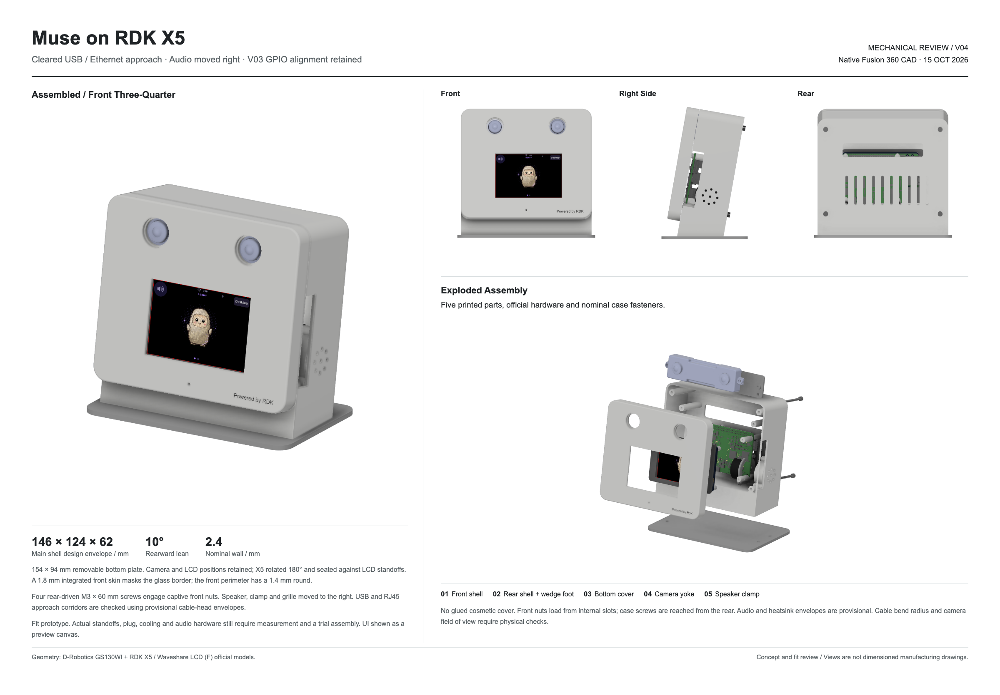

# Enclosure CAD

[V04](v04/README.md) is the current editable fit prototype. It contains the
Fusion archive, assembly/part STEP files, five STL print parts, screenshots and
CAD check reports. The files are checked into Git; no download from a chat is
needed.

## Revision history

- V01: initial camera/screen/X5 layout.
- V02: concealed LCD border, light front shell, rear screws and captive nuts.
- V03: correct X5's 180-degree orientation and seat it against the LCD standoffs.
- V04: move provisional audio to the right and clear USB/Ethernet cable approach.

Only V04 is distributed here. Earlier revisions and intermediate studies should
not be used for printing. A passed collision check is not a physical fit test.

The 28 x 12 mm round speaker and 6 mm microphone remain placeholders. The proposed
Waveshare 2030 rectangular speaker and PAM8302 amplifier mounts are not finished.
Cooling, final cable retention, pogo stroke and physical assembly remain open.

## Vendor reference geometry

The assembly embeds vendor STEP geometry as references; it does not modify the
camera's stereo baseline or internal construction. Vendor geometry and marks
remain the property of their respective owners. The repository's code license
does not grant additional rights to those vendor materials.

- [GS130WI official STEP](https://archive.d-robotics.cc/downloads/hardware/accessories/gs130wi/RDK%20Stereo%20Camera%20GS130WI%20Community.STEP)
- [RDK X5 hardware downloads](https://archive.d-robotics.cc/downloads/hardware/rdk_x5/)
- [Waveshare 3.5inch RPi LCD (F)](https://www.waveshare.com/3.5inch-rpi-lcd-f.htm)

`v04/manifest-sha256.json` records file hashes after reorganizing the original
exports. The native Fusion timeline and user parameters are the editable design;
the part STL files are export meshes.
